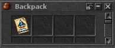

# Boat Pass (30 days)

Implemented and verified locally on 2026-10-25. Not published or deployed.
The user approved the brown-hull, blue-sail artwork with “Det där blir bra. Kör.”
The imported native 32×32 PNG is byte-identical to that approved PixelLab image.

| SID | CID | Sprite | Prototype | Shop offer | Price | Weight |
| --- | --- | --- | --- | --- | --- | --- |
| 12866 | 11903 | 36700 | 5943, ordinary consumable | 4005 | 100 points, provisional | 1 oz |

The existing Admin/God command `/i 12866` can create a pass for local inspection.
Normal players obtain it from the shop. Buying delivers an item; time starts
only when the player uses it. One use consumes exactly that pass and adds
30×86400 seconds to the account, extending any remaining time. It grants free
boat fares to all characters on the account and does not grant Premium.

## Persistence and travel

`Player:redeemBoatPass` shares Premium Scrolls' native inventory transaction.
The current character/shop debit is saved first. Inventory removal and account
expiry are then committed in the same SQL transaction, with the account row
locked. Failed saves, invalid ownership, wrong items, overflow and SQL failure
leave the pass intact. An uncertain commit disconnects the stale character and
blocks its saves until login reloads authoritative inventory/account state.

Migration 33 upgrades database version 33→34 by adding
`accounts.boat_pass_ends_at INT UNSIGNED NOT NULL DEFAULT 0`. Fresh schema SQL
also includes it. The startup schema gate requires the column and InnoDB for
accounts as well as the existing durable inventory/store tables. A new server
binary and migration are required; copying Lua alone is insufficient.

The shared fare helper reads committed account time when quoting and boarding.
It covers all 11 registered routes; existing zero-cost journeys remain free.
An unavailable entitlement lookup refuses paid-route boarding without charging.
If a free quote becomes paid before confirmation, the player must reopen the
station. A newly activated pass can lower a pending fare. Failed rides refund
only the actual amount paid, so a failed free ride cannot create gold.

Quest/password access, tradepack restrictions, one-use pending responses,
proximity, floor, session and station identity checks remain in place. Ferryman
journeys are already free. Captain Voss currently has no active destinations.
Generic NPC transport was left unchanged. Detailed route audit:
[verification.json](verification.json).

## Verification performed

- Release build from all 178 matching current C++ source files; separate
  loopback-gated fault-injection build. Both succeeded. MSBuild's existing
  missing `pwsh.exe` post-build hook was nonfatal; runtime dependencies were
  packaged separately for QA.
- 50 current-engine checks: shop grant/debit and delivery refusal, native item
  definition, actual Use packets and replay, 30-day activation/extension,
  expired time, independent Premium, account sharing/isolation, unowned items,
  overflow, save/SQL/lookup failure, persistence and reconnect.
- Actual Spider Island trips to the destination: ordinary fare 15 gold;
  active pass with no carried gold, fare 0. Actual quote packets also checked
  insufficient funds, paid/free ride failure, expired free quotes and forged
  replies rejected by the existing protocol admission gate.
- Three separate fault runs passed: uncertain commit before/after, and process
  crash after commit. Reconnect recovered exactly one consistent outcome for
  both pass consumption and account time, including a subsequent save.
- 59 existing native Premium Scroll checks passed through the shared code,
  including ordinary saves, failure rollback, existing Quiver/Keyring shop
  behavior and Premium add/remove APIs.
- 222 fare-source checks exercised all 11 actual route configurations and
  quest/tradepack rules, quotes, invalid/replayed pending responses, refunds,
  expiry changes, missing account lookup and failed delivery of the dialog.
  115 existing/extended shop/admin source checks passed.
- Approved pixels round-trip through SPR unchanged. All 12,288 existing DAT
  records, 12,766 OTB records, 36,699 sprites and prior XML entries preserved.
- Actual retro client bag movement, look and inventory rendering passed with
  current item assets and checksums exported from the final private encrypted
  archive. This visual run used the existing matched older QA client/server;
  new native activation and travel were verified separately above.

All database mutations used cold, owned loopback copies. Source database,
source configuration and client QA profile were preserved/restored; every
owned test process stopped. Initial test failures were fixture mistakes, fixed
without weakening gameplay; details are retained in the verification receipt.

Only Spider Island was travelled end-to-end natively. The remaining routes
were exercised through their actual configuration/fare/access source. No new
protected RH2 client/archive, updater package, DEV deployment, live restart,
commit or push was performed.

[Full screenshot](ingame-inventory.png) · [Verification receipt](verification.json)
