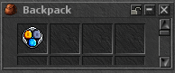

# Magic Gold Converter

Implemented and verified locally. Not published or deployed.
The user approved PixelLab's three-coin medallion with “Ja kör på.”
The imported native 32×32 PNG is byte-identical to the approved source, with
binary transparency; the prior box and stamping-tool concepts remain archived.

| SID | CID | Sprite | Prototype | Shop offer | Price | Weight |
| --- | --- | --- | --- | --- | --- | --- |
| 12867 | 11904 | 36701 | 5943, ordinary movable static item | 4006 | 100 points, provisional | 1 oz |

Normal players purchase one permanent converter from the shop. The existing
Admin/God command `/i 12867` can create it for local inspection. It has no charges
and does not require equipping. Carrying it, including inside nested carried
bags, enables automatic conversion within one second:

- 100 ordinary gold coins → 1 platinum coin.
- 100 ordinary platinum coins → 1 crystal coin.
- The gold promotion can complete a platinum group in the same conversion.

Remainders stay in their existing stacks. Existing crystal coins are retained.
The converter is not consumed. Using it explicitly attempts the same conversion
and reports a refusal or that it is active. A converter on the ground, in a
depot or belonging to another player does not activate the effect.

## Integration and guarantees

`data/lib/magic_gold_converter.lua` selects exact ordinary carried coin stacks
and prepares promoted coins. It calls the existing native `inventoryTransaction`
with no gold fee and no item replacement. Native preflight checks ownership,
counts, trade state, bag rules, available slots and final carrying weight before
applying all removals and outputs together. Failed output creation or preflight
leaves the original coins intact and releases prepared outputs. No C++ payment,
inventory planner, persistence or protocol rules were changed.

A registered one-second GlobalEvent supplies automatic operation, including
after pickup, rewards, bank withdrawals and purchase change. It does not hook
inside money operations. Native trade locks pause conversion; ownership is
checked again on subsequent ticks. Store seller mode is also excluded. Quarantine
recovery removes stale players from the game through the existing native paths.

Coin instances with any attributes, such as quest IDs or custom marks, are left
intact. Only carried slots and nested carried containers are scanned. The
converter never selects bank balances, depot contents or coins on the ground.
It changes denominations upward only and preserves total currency value.

A carried bag must have a compatible existing stack or a slot for the result.
A completely consumed coin stack inside a full bag frees a usable slot in the
same native plan. If only an equipment-slot stack is consumed and every bag is
full, conversion waits for room; no coin is lost or dropped. Weight-reducing
conversion is allowed while overloaded by the existing native planner.

## Verification performed

- **54 current-engine checks**, including ordinary player/capacity flags,
  native item mapping/weight, real shop purchase/debit and refusal, boundaries,
  cascading promotion, split stacks, nested converter, tagged currency,
  full-bag refusal and slot reuse, overloaded conversion, personal-store mode,
  bank/depot exclusion, payment with crystal coins and gold/platinum change,
  deposit/withdrawal, a 10,100-gold inventory, prepared-output failure, failed
  save rollback and subsequent successful save.
- **Eight real protocol requests:** owned and ground Use, gold pickup without
  a converter, converter pickup enabling automatic exchange, pickup of the
  last gold coin completing a stack, player trade request, rope counter-offer
  and acceptance by both players. No test bypassed trade or normal capacity.
  Automatic conversion paused during trade, then activated for the recipient
  and stopped for the sender. Both states survived actual logout/reconnect.
- **77 denomination combinations** ran through the actual conversion library
  with an inventory model, plus ownership/action, failure, output cleanup,
  repeat-tick and attributed-currency cases: 15,217 assertions. Native room,
  bag placement and trade behavior were checked separately above.
- **124 shop/admin source checks** passed, covering the converter and retained
  offers. The catalog contains ten entries before the two deferred outfits.
- **Asset integrity:** every prior 12,289 DAT record, 12,767 OTB record,
  36,700 sprite and existing XML entry preserved. The approved PNG round-trips
  through SPR unchanged.
- **Native retro rendering:** actual bag movement and look with the current
  DAT/SPR/OTB/XML passed. Checksums were exported from the final encrypted
  private QA archive and enforced. This visual run used the existing matched
  older QA client/server; current gameplay used the ordinary Release engine
  whose SHA256 matches the Boat Pass build and all 178 unchanged current C++
  files. A fresh C++ build was unnecessary for these Lua/asset changes.

All database mutations used owned cold loopback copies. Source database and
configuration were unchanged, the client QA profile was restored, and all owned
test processes stopped. Initial fixture setup failures and the ground-Use guard
correction are recorded in [verification.json](verification.json).

Depot scope was tested using an owned detached depot chest, without exercising
a real map depot interaction. No new protected RH2 client/archive, updater
package, DEV deployment, live restart, commit or push was performed.

[Full screenshot](ingame-inventory.png) · [Verification receipt](verification.json)
